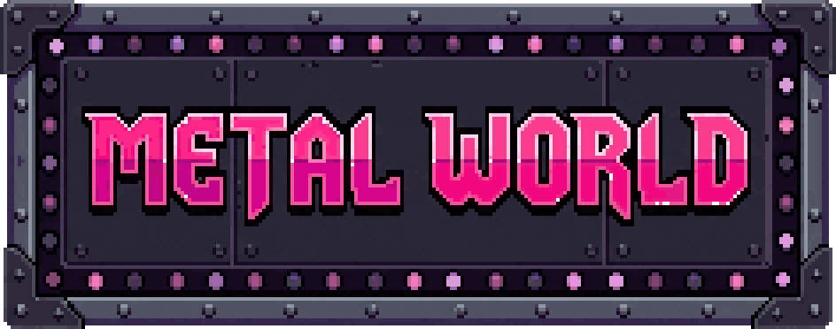
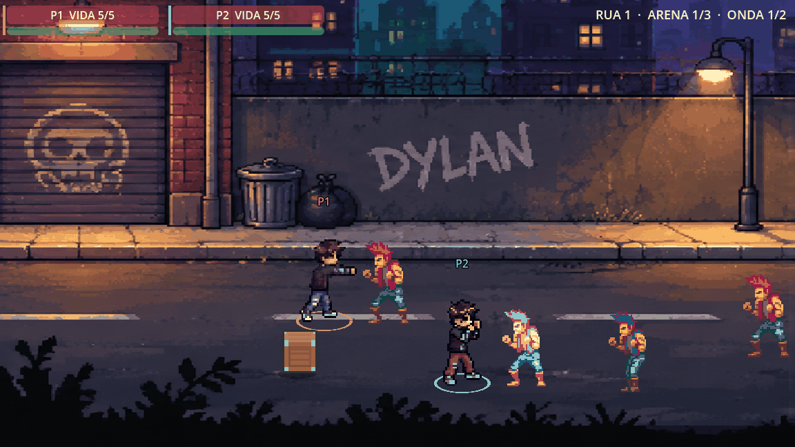
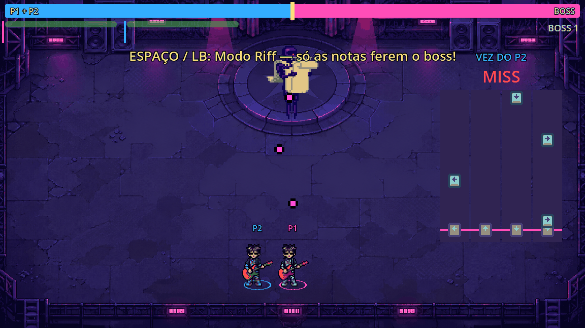

  

<h3 align="center">The Last Riff — beat 'em up co-op onde os chefes só caem no ritmo</h3>

  Godot 4.7 · GDScript · Pixel art · 1–2 jogadores · ExpoTech 2026.2 (UniFECAF)

---

Dylan Walker nasceu surdo e descobriu o heavy metal no dia em que ganhou um aparelho auditivo. Agora ele atravessa as ruas no soco, e quando chega a hora do chefe, saca a guitarra: **o chefe só perde vida no Riff**, um minigame de ritmo. Em dupla, os dois jogadores revezam as notas e dividem uma vida só contra o chefe.

## Destaques

- **Co-op local para 2 jogadores**: o P2 entra a qualquer momento; quem cai é levantado pelo parceiro.
- **Combate justo**: inimigos piscam antes de atacar; dá para desviar, sair da faixa ou socar para cancelar.
- **Profundidade de beat 'em up**: personagens passam na frente e atrás uns dos outros.
- **Riff**: notas a 150 BPM no tempo da música, acelerando quanto mais tempo vocês ficam tocando; em dupla, blocos alternam entre P1 (rosa) e P2 (azul) e às vezes os dois tocam juntos. Levou dano? Expulso do Riff e ele trava por um tempo.
- **Chefe em 3 fases**: escudo de runas, capangas, teleporte, nota maldita e cabo de força (vida compartilhada).
- **6 fases**: Rua 1 → Boss 1 → Rua 2 → Boss 2 → Rua 3 → Boss 3.

## Como jogar

| Ação | P1 (teclado) | P2 (controle) |
|---|---|---|
| Mover | WASD | Analógico / direcional |
| Socar | J | X |
| Dodge | K | A / RB |
| Interagir / levantar parceiro | E | B |
| Abrir/fechar Riff | Espaço | LB |
| Notas do Riff (← ↑ ↓ →) | A W S D | Setas / X Y A B |
| Entrar / reiniciar | Enter / R | START |
| Pausar (e remover o P2) | Esc | START |

## Como executar

1. Instale o [Godot 4.7](https://godotengine.org/download) (versão padrão).
2. Abra o `project.godot` e aperte **F5**.
3. Testes automatizados: `tests/rodar_testes.sh` (ou `GODOT=/caminho/do/godot tests/rodar_testes.sh`).

## Documentação

- 📄 **[Documentação técnica](docs/DOCUMENTACAO.md)**: proposta, requisitos, funcionalidades, arquitetura, fluxos e testes.
- 🧭 [Regras do projeto e como criar inimigos e chefes](AGENTS.md)
- 🌿 [Guia de Git da equipe](docs/GUIA_GIT.md)
- 🎨 [Créditos e licenças dos assets](CREDITS.md)

## Equipe

| Integrante | Papel |
|---|---|
| Lucas Gabriel Vieira do Nascimento | Líder, base do jogo, sprites (PixelLab) e integração |
| Leonardo Malafaia Kalil Honeim | Ruas 2 e 3 |
| Arthur Lima Pereira | Bosses 2 e 3 |
