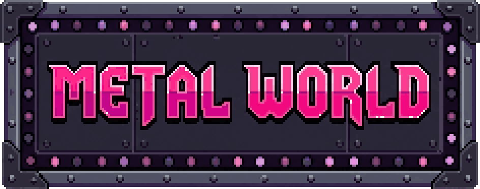
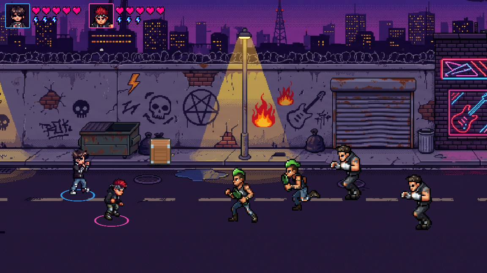
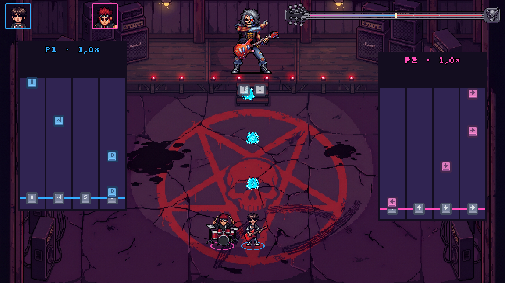

  

<h3 align="center">The Last Riff — beat 'em up co-op onde os chefes só caem no ritmo</h3>

  Godot 4.7 · GDScript · Pixel art · 1–2 jogadores · ExpoTech 2026.2 (UniFECAF)

---

Dylan Walker nasceu surdo e descobriu o heavy metal no dia em que ganhou um aparelho auditivo. Agora ele e o baterista Kevin atravessam as ruas no soco, e quando chega a hora do chefe, sacam os instrumentos: **o chefe só perde vida no Riff**, um minigame de ritmo. Em dupla, cada jogador tem suas próprias pistas e a dupla divide uma vida só contra o chefe.

## Destaques

- **Co-op local para 2 jogadores**: o P2 entra a qualquer momento; quem cai é levantado pelo parceiro.
- **Dois personagens**: cada jogador escolhe **Dylan** (guitarra) ou **Kevin** (bateria), cada um com seus golpes especiais.
- **Combate justo**: combo de soco, soco e chute; inimigos piscam antes de atacar, e dá para desviar, sair da faixa ou socar para cancelar.
- **Minirriff nas ruas**: sequências de 4 notas viram golpes especiais (onda sonora, raio encadeado, bumbo…), gastando a barra de poder.
- **Profundidade de beat 'em up**: personagens passam na frente e atrás uns dos outros.
- **Inimigos com cara de cada rua**: a gangue punk e o miniboss da Rua 1; a orquestra possuída (violinista, trombonista, tubista) e o Maestro na Rua 2.
- **Riff**: notas a 150 BPM no tempo da música, acelerando quanto mais tempo vocês ficam tocando; em dupla, as pistas ficam à esquerda para o P1 e à direita para o P2. Cada nota causa 1× de dano jogando sozinho; em dupla, 0,5× com só um Riff aberto e 1× quando os dois estão tocando. Esquivar fecha o próprio Riff. Dano interrompe e trava o Riff de quem foi atingido.
- **Chefes em 3 fases**: o guitarrista morto-vivo do galpão (Boss 1) e o duelo de Paganini contra o Diabo (Boss 2), com totens que desligam os instrumentos, nota maldita e cabo de força (vida compartilhada).
- **6 fases**: Rua 1 → Boss 1 → Rua 2 → Boss 2 → Rua 3 → Boss 3. A Rua 3 e o Boss 3 ainda estão em desenvolvimento.

## Como jogar

| Ação | P1 (teclado, esquerda) | P2 (teclado, direita) | Controle (P1 ou P2) |
|---|---|---|---|
| Mover | W A S D | Setas | Analógico / direcional |
| Socar (combo) | F | J | X |
| Dodge | G | K | B |
| Interagir / levantar parceiro | Y | L | RB |
| Abrir/fechar Riff | T | I | A |
| Notas do Riff (← ↑ ↓ →) | W A S D | Setas | LT / LB / RB / RT |
| Minirriff nas ruas (notas A e B) | T e Y | I e L | LB e RB |
| Entrar / reiniciar | R | J | START |
| Pausar (e remover o P2) | Esc | P | START |
| Tela cheia / janela | F11 ou Alt+Enter | F11 ou Alt+Enter | — |

Dá para jogar em dupla num teclado só: cada um fica com uma metade. O controle serve ao P1 ou ao P2: com dois controles, um para cada; com um só, ele é do P1 até o P2 entrar apertando START nele (com o P1 no teclado). Cada jogador troca sozinho entre teclado e controle: vale o último que tocou.

## Como executar

1. Instale o [Godot 4.7](https://godotengine.org/download) (versão padrão).
2. Abra o `project.godot` e aperte **F5**. Pelo editor o jogo abre em janela; exportado, abre em tela cheia.
3. Testes automatizados: `tests/rodar_testes.sh` (ou `GODOT=/caminho/do/godot tests/rodar_testes.sh`).

## Documentação

- 📄 **[Documentação técnica](docs/DOCUMENTACAO.md)**: proposta, requisitos, funcionalidades, arquitetura, fluxos e testes.
- 🎬 [Roteiro do vídeo pitch](docs/ROTEIRO_PITCH.md)
- 🧭 [Regras do projeto e como criar inimigos e chefes](AGENTS.md)
- 🌿 [Guia de Git da equipe](docs/GUIA_GIT.md)
- 🎨 [Créditos e licenças dos assets](CREDITS.md)

## Equipe

| Integrante | Papel |
|---|---|
| Lucas Gabriel Vieira do Nascimento | Líder, base do jogo, sprites (PixelLab) e integração |
| Leonardo Malafaia Kalil Honeim | História original, Ruas 2 e 3 |
| Arthur Lima Pereira | Bosses 2 e 3 |
