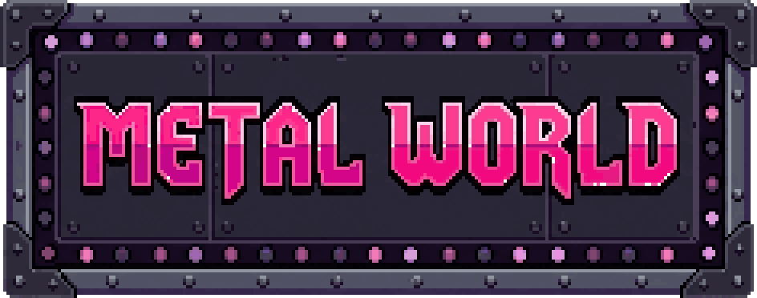
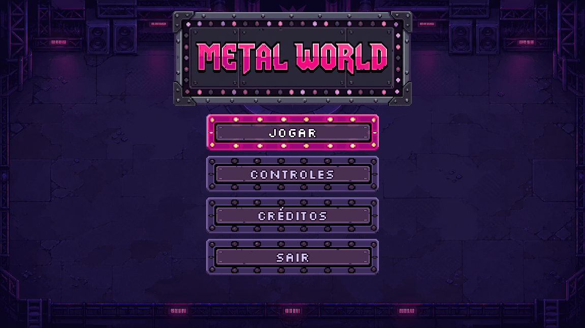
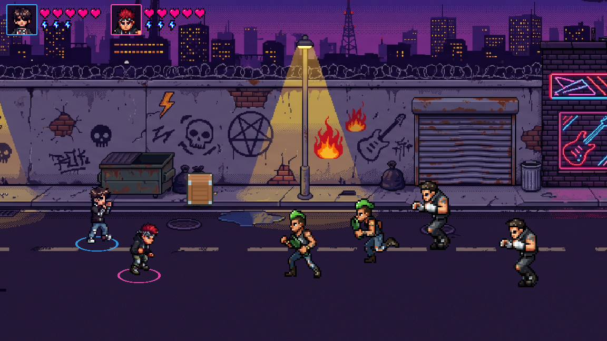
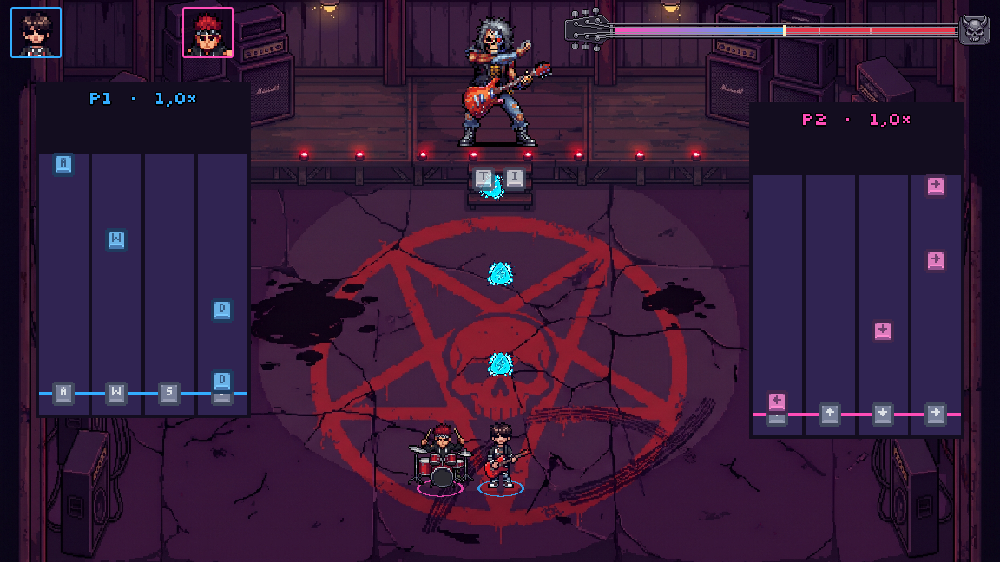
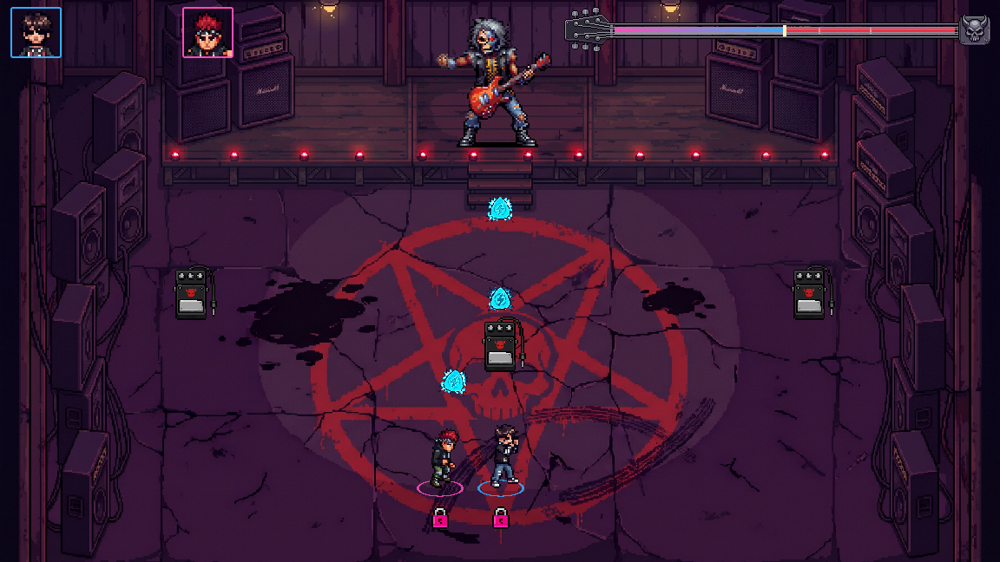
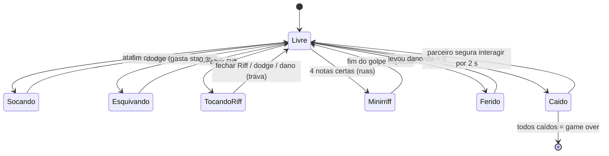
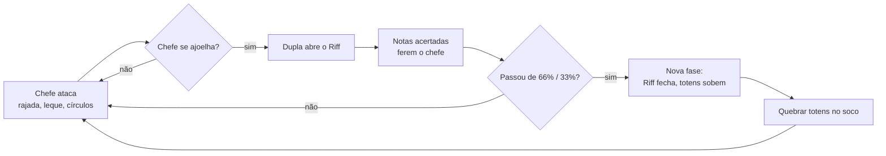
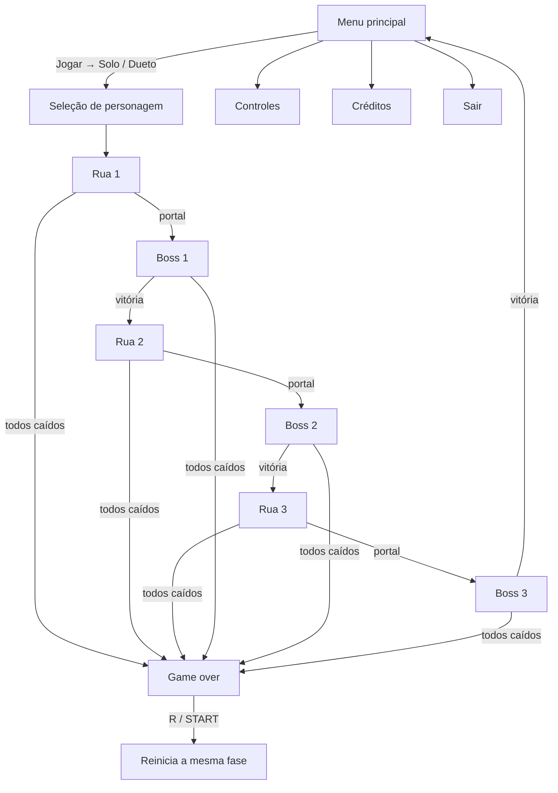
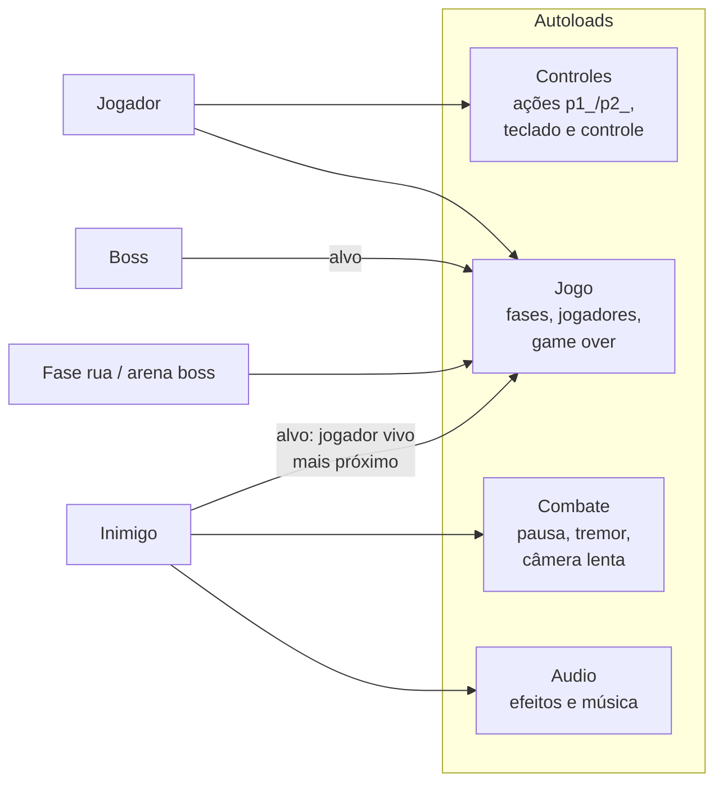
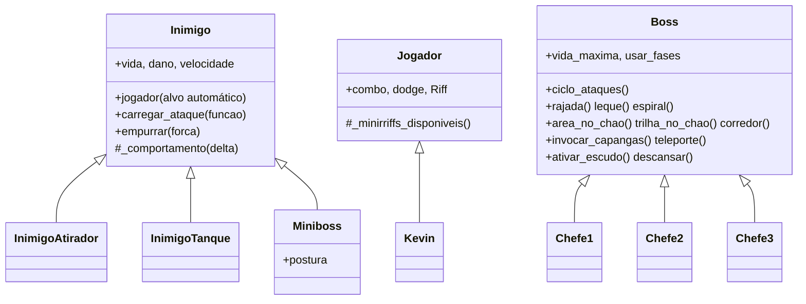

# MetalWorld: The Last Riff — Documentação técnica

> ExpoTech 2026.2 · UniFECAF · ADS 5º semestre (noite)
> Equipe: Lucas Gabriel Vieira do Nascimento (líder), Arthur Lima Pereira, Leonardo Malafaia Kalil Honeim



## Sumário

1. [Visão geral](#1-visão-geral)
2. [Problema e proposta](#2-problema-e-proposta)
3. [Público-alvo](#3-público-alvo)
4. [Requisitos](#4-requisitos)
5. [Funcionalidades](#5-funcionalidades)
6. [Mecânicas em detalhe](#6-mecânicas-em-detalhe)
7. [Fluxo de telas e fases](#7-fluxo-de-telas-e-fases)
8. [Arquitetura](#8-arquitetura)
9. [Controles](#9-controles)
10. [Qualidade e testes](#10-qualidade-e-testes)
11. [Processo de desenvolvimento](#11-processo-de-desenvolvimento)
12. [Identidade visual](#12-identidade-visual)
13. [Como executar](#13-como-executar)
14. [Créditos e licenças](#14-créditos-e-licenças)
15. [Próximos passos](#15-próximos-passos)

---

## 1. Visão geral

**MetalWorld: The Last Riff** é um jogo 2D de pancadaria lateral (*beat 'em up*) em pixel art, com **co-op local para 2 jogadores** e um diferencial: os chefes **só são derrotados no ritmo**, num minigame de guitarra chamado **Riff**.

A história, criada pelo Leonardo, acompanha **Dylan Walker**, um jovem que nasceu surdo e descobre a paixão pela música quando recebe um aparelho auditivo e ouve heavy metal pela primeira vez. Ao lado do baterista **Kevin**, ele abre caminho nas ruas no soco; diante de cada chefe, os dois sacam os instrumentos e lutam com música.

| | |
|---|---|
| Gênero | Beat 'em up + ritmo |
| Jogadores | 1 ou 2 (co-op local, mesma tela) |
| Personagens | Dylan (guitarra) e Kevin (bateria) |
| Plataforma | PC (Windows/Linux) |
| Motor | Godot 4.7 (GDScript), renderizador de compatibilidade |
| Estrutura | Rua 1 → Boss 1 → Rua 2 → Boss 2 → Rua 3 → Boss 3 |



## 2. Problema e proposta

**Problema.** Jogos de pancadaria costumam ser repetitivos no fim de fase: o chefe é só "mais um inimigo com mais vida". E jogos de ritmo raramente são jogados em dupla, no sofá, com outra pessoa.

**Proposta.** Unir os dois:
- **Nas ruas**, combate corpo a corpo justo e legível: inimigos avisam antes de bater, há profundidade (dá para passar na frente/atrás) e cooperação (levantar o parceiro caído).
- **No chefe**, a música é a arma. O chefe só perde vida pelo **Riff**: notas descem em pistas e os jogadores acertam no tempo. Em dupla, cada jogador tem **pistas próprias** (P1 à esquerda e P2 à direita), e a dupla divide **uma vida só** contra o chefe (cabo de força).
- **Tema de inclusão.** O protagonista é surdo, e a música aparece também de forma **visual**: notas coloridas, aviso "RIFF!" e feedback na tela, para jogar sem depender só do som.

## 3. Público-alvo

- Jogadores casuais que gostam de jogar **em dupla no mesmo computador**.
- Fãs de beat 'em ups clássicos e de jogos de ritmo.
- Faixa etária: 12+ (violência cartunesca, sem sangue).

## 4. Requisitos

### 4.1 Funcionais

| ID | Requisito | Situação |
|---|---|---|
| RF01 | Menu principal com Jogar (Solo ou Dueto), Controles, Créditos e Sair | ✅ Implementado |
| RF02 | Jogar com 1 ou 2 jogadores; o 2º pode entrar no meio da fase (START) | ✅ Implementado |
| RF03 | Teclado dividido ao meio para os dois jogadores e controle para qualquer um deles (vale o último dispositivo que o jogador tocou) | ✅ Implementado |
| RF04 | Combate corpo a corpo: combo de soco, soco e chute, esquiva (dodge) com stamina | ✅ Implementado |
| RF05 | Inimigos com ataque telegrafado (piscam antes de bater), alvo no jogador mais próximo e IA de grupo (2 atacam por vez, os outros cercam) | ✅ Implementado |
| RF06 | Fases de rua em arenas e ondas, com portal para o chefe | ✅ Implementado |
| RF07 | Objetos quebráveis (barris e caixotes) que soltam comida que cura | ✅ Implementado |
| RF08 | Jogador caído pode ser levantado pelo parceiro; game over só com os dois caídos | ✅ Implementado |
| RF09 | Chefe que só toma dano pelo minigame de ritmo (Riff) | ✅ Implementado |
| RF10 | Riff independente para cada jogador, com pistas por cor | ✅ Implementado |
| RF11 | Chefe com fases, totens que desligam os instrumentos, ataques próprios e nota maldita | ✅ Implementado (Bosses 1 e 2) |
| RF12 | Vida compartilhada da dupla contra o chefe (cabo de força) | ✅ Implementado |
| RF13 | Sequência de 6 fases, voltando ao menu ao fim | ✅ Implementado |
| RF14 | Ruas e chefes com inimigos, cenário e ataques próprios | ✅ Ruas 1 e 2, Bosses 1 e 2 · 🛠 Rua 3 e Boss 3 em desenvolvimento (modelos jogáveis) |
| RF15 | Seleção de personagem: cada jogador escolhe Dylan ou Kevin, sem repetir | ✅ Implementado |
| RF16 | Minirriff nas ruas: sequências de 4 notas viram golpes especiais com barra de poder | ✅ Implementado |
| RF17 | Minibosses nas ruas com barra de vida própria (o da Rua 1 tem postura que quebra) | ✅ Implementado (Ruas 1 e 2) |

### 4.2 Não funcionais

| ID | Requisito |
|---|---|
| RNF01 | Rodar em PCs modestos: renderizador de compatibilidade (OpenGL), resolução base 1152×648 ampliada para tela cheia (16:9, com barras pretas em outras proporções) |
| RNF02 | Pixel art nítida: filtro *nearest*, sem borrão ao ampliar |
| RNF03 | Jogável com teclado e controle; menus navegáveis pelos dois |
| RNF04 | Testes automatizados sem janela (*headless*) cobrindo fases, co-op, combate e menu |
| RNF05 | Código e textos em português; organização de pastas por funcionalidade (padrão do Godot) |
| RNF06 | Visual configurado nas cenas (Inspector), para o editor mostrar o mesmo que o jogo |
| RNF07 | Uso apenas de assets com licença compatível, todos listados em `CREDITS.md` |

## 5. Funcionalidades

### Ruas (beat 'em up)



- **Combo** (F / J / X): soco (1 de dano), soco (2) e chute (2, empurra). O jogador para para bater; apertar durante o golpe guarda o próximo.
- **Dodge** (G / K / B) com stamina: atravessa inimigos e tiros. O anel no pé mostra a recarga.
- **Minirriff**: nas ruas, cada jogador toca notas A (T / I / LB) e B (Y / L / RB). Uma sequência de 4 notas dentro do prazo vira um golpe especial e gasta a barra de poder, que enche com o tempo, acertando socos e levando dano. As notas aparecem como teclas em cima do jogador e piscam douradas no acerto ou vermelhas no erro.

  | Personagem | Sequência | Golpe |
  |---|---|---|
  | Dylan | A B A B | Onda sonora: dano em volta e atordoa |
  | Dylan | B B A B | Raio encadeado: ricocheteia em até 3 inimigos |
  | Dylan | B A B A | Acorde cortante: arco que avança e atravessa até 2 inimigos (4 de dano) |
  | Kevin | A B A B | Bumbo: duas batidas em volta. A segunda alcança mais longe e empurra. |
  | Kevin | A B B A | Caixa: projétil forte |
  | Kevin | A A B B | Virada: três projéteis, o último empurra |

- **Inimigos**: todos **carregam o golpe** piscando branco: dá para sair da faixa, desviar ou socar para cancelar. **IA de grupo** (estilo Castle Crashers): cada jogador tem 2 vagas de ataque, uma de cada lado; quem pega a vaga bate 2 vezes, recua e dá a vez, e os outros cercam o jogador pelos dois lados, à distância. Quem nasce atrás do jogador surge longe da tela.
  - **Rua 1 (gangue punk)**: brigão, corredor, atirador (tiro na faixa) e grandão (granada em arco que explode), além do **miniboss**: postura que quebra com golpes seguidos, áreas de dano no chão e barra de vida.
  - **Rua 2 (orquestra possuída)**: violinista (atira notas), trombonista, tubista (bola demoníaca) e o **Maestro**, que rege notas contra os jogadores e tem barra de vida.
- **Profundidade**: colisão só nos pés; personagens passam na frente/atrás uns dos outros e dos objetos.
- **Impacto**: pausa curta e tremor de tela nos acertos; câmera lenta no último inimigo da rua.
- **Barris e caixotes** quebram na porrada e soltam maçã ou carne.
- **Portões**: entre as arenas, uma seta pisca para a direita quando a área está limpa e o portão leva à próxima.
- **HUD com ícones, quase sem texto**: retrato do personagem de cada jogador (moldura azul para o P1 e rosa para o P2, apagado quando cai), corações para a vida e raios para a stamina (um raio por dodge, enchendo enquanto recarrega). A barra do chefe tem moldura de braço de guitarra.
- **Entrada do P2 sem texto**: o lugar do P2 no HUD mostra uma silhueta piscando com o botão de entrar, no dispositivo que ele está usando. Ao entrar, o personagem do P2 chega correndo pela esquerda, o retrato acende e os corações enchem um por um.
- **Pause** (Esc / START): continuar, remover o jogador 2 (ele pode voltar com START) ou ir ao menu principal.

### Chefes (Riff)



- **Riff** (T / I / A abre e fecha): o Dylan puxa a guitarra e o Kevin puxa a bateria do chão. Notas descem em 4 pistas a 150 BPM, no tempo da música. O P1 toca com A W S D e o P2 com as setas (ou LT LB RB RT). PERFECT e GOOD ferem o chefe. Quanto mais tempo no Riff, mais rápido as notas caem (até 1,6x).
- **Riff em dupla**: P1 toca à esquerda e P2 à direita. Cada acerto causa 1× de dano jogando sozinho; em dupla, 0,5× com um jogador tocando ou 1× com os dois tocando.
- **Risco do Riff**: dano, inclusive de nota maldita, encerra o Riff de quem foi atingido e trava suas pistas por 5 s. Sair voluntariamente, inclusive com uma esquiva, trava por 1 s. Cada jogador tem seu cadeado, embaixo dos pés. O "!" pisca enquanto o chefe está fora do descanso.
- **Descanso**: o chefe se ajoelha e mostra "RIFF!": a hora segura de tocar.
- **Fases do chefe** (66% e 33% da vida, marcadas na barra): ataques novos, ritmo mais rápido, nota maldita e totens.
- **Totens**: ao mudar de fase, o chefe ergue totens que desligam os instrumentos. O Riff só volta depois que a dupla quebra todos no soco; o cadeado embaixo de cada jogador mostra a espera.
- **Cabo de força**: uma barra só, dupla × chefe. Dano em qualquer jogador cura o chefe; dano no chefe cura a dupla.
- **Boss 1, o guitarrista morto-vivo do galpão**: palhetas em rajada, leque e espiral, microfonia (círculos no chão), trilha que persegue os dois jogadores, corrida pelo palco e pedais como totens.
- **Boss 2, Paganini contra o Diabo**: um duelo no salão de concertos com uma vida só. Os dois trocam leques de notas, staccato, pinball que ricocheteia nas paredes e contratempo; a partir da fase 2 as Quatro Cordas vibram junto, e notas que se chocam abrem a Dissonância. O metrônomo é o totem.



### Co-op

- P2 entra a qualquer momento. Cada jogador escolhe o personagem no menu (os dois não podem pegar o mesmo); anel e Riff do P1 em azul e do P2 em rosa.
- Quem cai fica no chão; o parceiro segura **interagir** (Y / L / RB) perto para levantar (com metade da vida).
- Inimigos e chefe miram sempre um jogador **vivo**.

## 6. Mecânicas em detalhe

### Estados do jogador



### Ciclo do combate contra o chefe



### Dano e equilíbrio (valores principais)

| Item | Valor |
|---|---|
| Vida do jogador | 5 (cabo de força no chefe: dupla com 5 de 10) |
| Combo (soco / soco / chute) | 1 / 2 / 2 de dano |
| Barra de poder (Minirriff) | 3; golpes especiais custam 1 a 3 |
| Carga do ataque inimigo | 0,45 s (tanque 0,6 s) |
| Atacantes por jogador | 2 (um de cada lado), 2 golpes cada antes de dar a vez |
| Riff | 150 BPM; com fases, 6 PERFECT ≈ 1 fase do chefe |
| Velocidade de andar | ~2 corpos por segundo (proporcional ao tamanho) |

## 7. Fluxo de telas e fases



Cada **rua** tem arenas (uma tela cada) com ondas de inimigos; a câmera só avança quando a arena é limpa. Na última arena abre o **portal** para o chefe.

Na seleção, cada jogador anda entre os cartões com os próprios comandos e confirma com atacar; no Dueto os dois confirmam e não podem pegar o mesmo personagem. A fase troca o Dylan gravado na cena pelo personagem escolhido.

## 8. Arquitetura

### 8.1 Organização de pastas

Organizada **por funcionalidade** (recomendação do guia oficial do Godot): cena, script e sprites de cada coisa ficam juntos.

| Pasta | Conteúdo |
|---|---|
| `sistemas/` | Autoloads (serviços globais): `Jogo`, `Controles`, `Audio`, `Combate` |
| `personagens/` | `dylan/` (jogador base: cena, script, Minirriff, marcadores, sprites), `baterista/` (Kevin) e `miku/` (personagem secreta) |
| `inimigos/` | `base/` (modelos `Inimigo` e miniboss), `rapido/`, `atirador/`, `tanque/` |
| `bosses/base/` | Classe `Boss` (caixa de ferramentas de ataques), arena, totem, projéteis |
| `riff/` | HUD do Riff e notas |
| `objetos/` | Barril, caixote, comida, portal |
| `ui/` | Menu principal, seleção de personagem, controles, pausa, HUD, barras de vida, cabo de força, ícones de comando |
| `fases/` | `comum/` (script das ruas, ondas), `rua_1..3/` e `boss_1..3/`, cada uma com os próprios inimigos, ataques e sprites |
| `assets/` | Áudio, fontes, fundos, efeitos e projéteis compartilhados |
| `tests/` | Testes automatizados |

### 8.2 Serviços globais (autoloads)



- **Jogo**: sequência das 6 fases, entrada do P2, lista de jogadores vivos, consulta do jogador mais próximo, game over.
- **Controles**: cria ações por jogador (`p1_atacar`, `p2_atacar`…) e distribui os controles conectados.
- **Audio** e **Combate**: sons/música e sensação de impacto, usados por qualquer cena.

### 8.3 Modelos de extensão (como a equipe cria conteúdo)



- **Inimigo novo**: cena herdada de `inimigos/base/inimigo.tscn`. Se só bate de perto, não precisa de script (já vem com a IA de grupo); com comportamento diferente, um script `extends Inimigo` que só escreve `_comportamento()`.
- **Chefe novo**: script `extends Boss` que só escreve `ciclo_ataques()` combinando os ataques prontos.
- **Rua nova**: ondas montadas no editor com nós `PontoSpawn`; sem script novo.
- **Personagem novo**: cena que herda o jogador; com golpes especiais próprios, um script que troca só a tabela de Minirriffs (como o Kevin). Entra na lista `Jogo.PERSONAGENS` e ganha um cartão na seleção.

### 8.4 Decisões técnicas

| Decisão | Motivo |
|---|---|
| Origem dos personagens nos pés e colisão só no chão | Profundidade de beat 'em up e ordem de desenho correta (y-sort) |
| Tiros acertam uma *Hurtbox* na altura do peito | Só acerta quem está na mesma faixa da rua |
| Visual gravado nas cenas, não em código | Editor mostra o mesmo que o jogo; equipe ajusta sem programar |
| Ações de controle por jogador geradas em código | Mesmo jogo serve 1 ou 2 jogadores, com ou sem controle |
| Áudio mudo em modo sem janela | Testes automatizados rodam sem placa de som |

## 9. Controles

| Ação | P1 (teclado, esquerda) | P2 (teclado, direita) | Controle (P1 ou P2) |
|---|---|---|---|
| Mover | W A S D | Setas | Analógico / direcional |
| Socar | F | J | X |
| Dodge | G | K | B |
| Interagir / levantar parceiro | Y | L | RB |
| Abrir/fechar Riff | T | I | A |
| Notas do Riff (← ↑ ↓ →) | W A S D | Setas | LT / LB / RB / RT |
| Minirriff nas ruas (notas A e B) | T e Y | I e L | LB e RB |
| Entrar na partida / reiniciar | R | J | START |
| Pausar | Esc | P | START |
| Tela cheia / janela | F11 ou Alt+Enter | F11 ou Alt+Enter | — |

O controle serve ao P1 ou ao P2: com dois controles, um para cada; com um só, ele é do P1 até o P2 entrar apertando START nele (com o P1 no teclado). Cada jogador troca sozinho entre teclado e controle: vale o último que tocou.

As telas e avisos mostram só as teclas de quem está jogando, no dispositivo que ele usou por último (ícones de teclado ou de controle).

O jogo exportado abre em tela cheia; pelo editor abre em janela, para os botões de depuração da aba Game funcionarem. Em telas que não são 16:9 aparecem barras pretas nas bordas, para o cenário ficar igual em qualquer monitor.

**Atalhos**: F9 derrota os inimigos da fase (no chefe, esvazia a vida dele e dá a vitória) para testar rápido; só funciona no editor e em builds de depuração, nunca no jogo exportado. F10 na seleção revela a personagem secreta.

## 10. Qualidade e testes

Testes automatizados rodam o jogo **sem janela** e simulam os botões dos dois jogadores:

```bash
tests/rodar_testes.sh
```

| Teste | O que verifica |
|---|---|
| `teste_fases.gd` | Joga as 6 fases em sequência com 2 jogadores até voltar ao menu |
| `teste_coop.gd` | Entrada do P2, mira dos inimigos, levantar parceiro, game over, Riff independente, reiniciar no meio do chefe, pause e remover o P2 |
| `teste_combate.gd` | Socos (alcance, faixa, empurrão), carga dos inimigos, atirador, profundidade, guitarra no Riff, tamanhos |
| `teste_novidades.gd` | Impacto, caixote e comida, ataques do chefe, escudo, fases, nota maldita, cabo de força |
| `teste_ia.gd` | IA de grupo: no máximo 2 atacando, revezamento, rodear à distância, não empilhar, vagas por jogador no co-op |
| `teste_menu.gd` | Navegação do menu, janelas de controles/créditos, iniciar sozinho/em dupla |
| `teste_controles.gd` | P1 no controle, troca entre teclado e controle e controle único passando ao P2 quando ele entra |
| `teste_selecao.gd` | Seleção de personagem: cada jogador escolhe o seu, sem repetir, e a fase usa o escolhido |

O script falha se **qualquer** teste falhar ou se aparecer erro de script durante a execução. Além disso, cada mudança visual é conferida por captura de tela.

## 11. Processo de desenvolvimento

- **Divisão**: Lucas (base do jogo, sprites no PixelLab, integração e revisão), Leonardo (história original, Ruas 2 e 3), Arthur (Bosses 2 e 3).
- **Trello**: Ideias → Backlog aprovado → To do → Doing → Testando → Done. Cada cartão em Testando tem checklist de teste manual.
- **GitHub**: um branch por tarefa e Pull Requests pequenos a cada 2–3 dias, revisados antes de entrar na `main` (guia em [`GUIA_GIT.md`](GUIA_GIT.md); modelo de PR em `.github/pull_request_template.md`).
- **Regras do projeto** para a equipe e para assistentes de código: [`AGENTS.md`](../AGENTS.md).
- **Decisões em grupo**: votação das funcionalidades no WhatsApp (o que entrou e o que ficou de fora está registrado no Trello).

## 12. Identidade visual


- **Conceito**: palco de show de heavy metal: aço rebitado, letreiro com lâmpadas e neon rosa.
- **Logo**: placa "METAL WORLD" em letras góticas rosa (`docs/identidade/logo_metalworld.png`, também usada no menu).
- **Pixel art** em todo o jogo, ampliada sem filtro.
- **Fonte**: Silkscreen (pixel, licença OFL) em todos os textos do jogo.

| Cor | Uso |
|---|---|
| `#FF4DB8` rosa | Marca, títulos e P2 (anel, Riff e retrato) |
| `#33ADFF` azul | P1 (anel, Riff, retrato e vida da dupla) |
| `#E4354A` vermelho | Vida dos chefes |
| `#E71982` rosa-choque | Botão aceso, destaques |
| `#493050` roxo-placa | Botões e molduras |
| `#292636` aço escuro | Placa do título |
| `#FFD94D` amarelo | Avisos e dicas |

## 13. Como executar

1. Instale o **Godot 4.7** (versão padrão, sem .NET).
2. Abra o arquivo `project.godot` e aperte **F5**.
3. Para jogar em dupla, dividam o teclado (P1 na metade esquerda, P2 na direita) ou usem controles: um para cada jogador ou um só para o P2, com o P1 no teclado.

## 14. Créditos e licenças

Todos os assets de terceiros, autores e licenças estão em [`CREDITS.md`](../CREDITS.md). Os sprites dos personagens e a interface foram gerados pela equipe no PixelLab; os demais assets são de licença livre, as músicas são CC0, os efeitos sonoros foram criados no Bfxr e a fonte é a Silkscreen (OFL).

## 15. Próximos passos

- **Rua 3 e Boss 3**: conteúdo próprio (hoje são modelos jogáveis); o Boss 3 está em desenvolvimento num branch separado.
- **História do jogo**: trazer mais da história original para dentro do jogo, como cenas entre as fases.
- **Arte própria** para os inimigos genéricos, objetos e efeitos que ainda usam pacotes de licença livre.
- Game over e vitória com arte própria, no mesmo estilo do menu.
