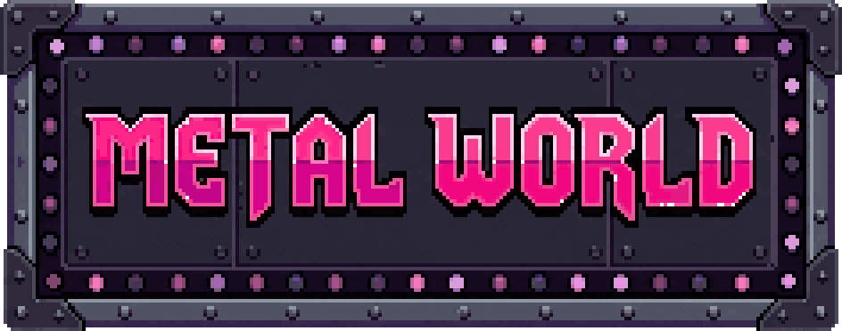
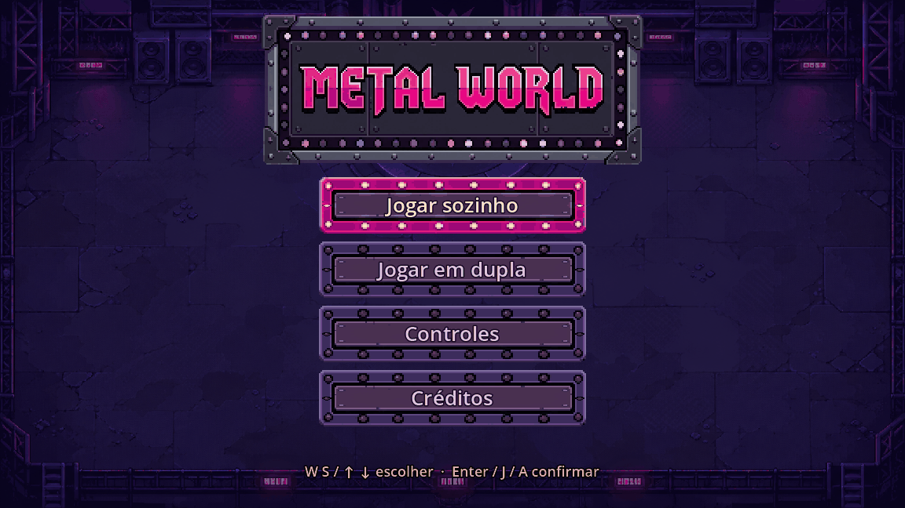
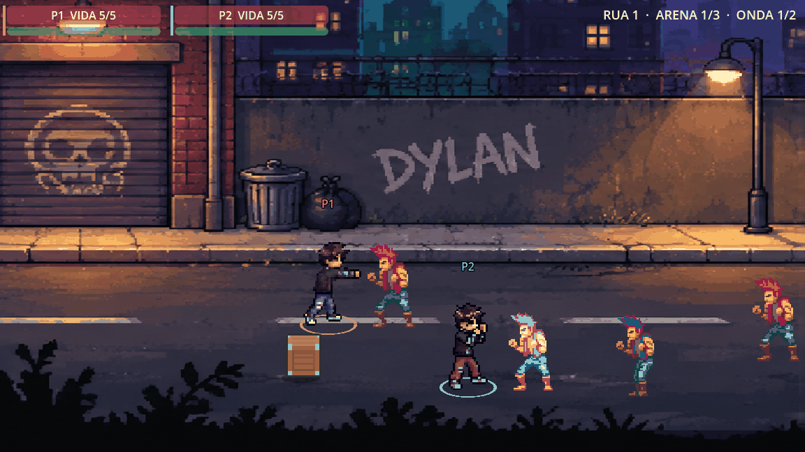
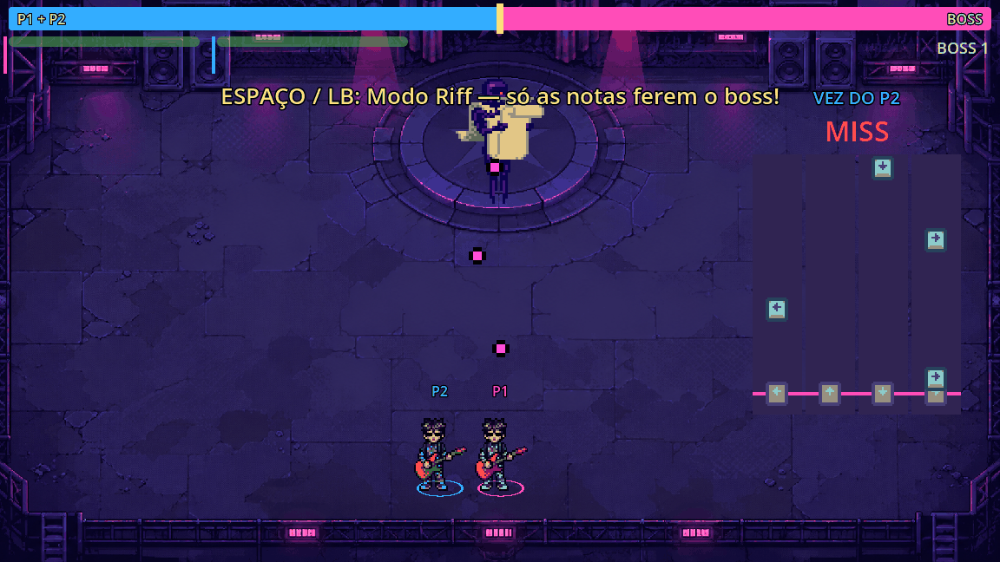
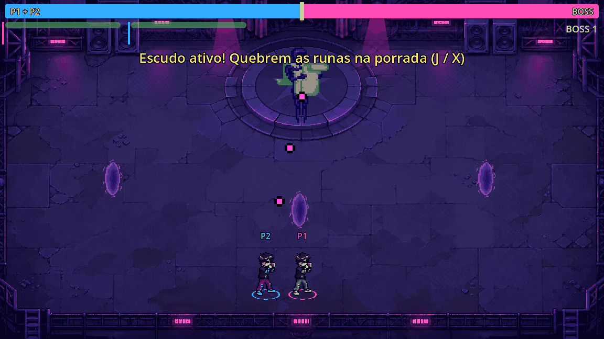
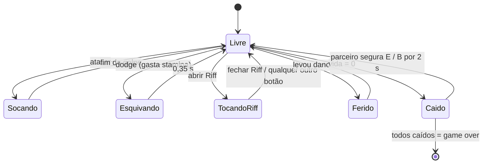
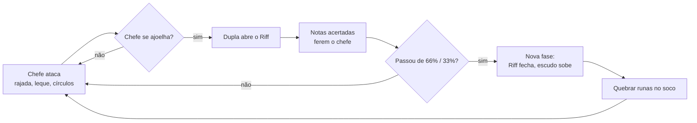
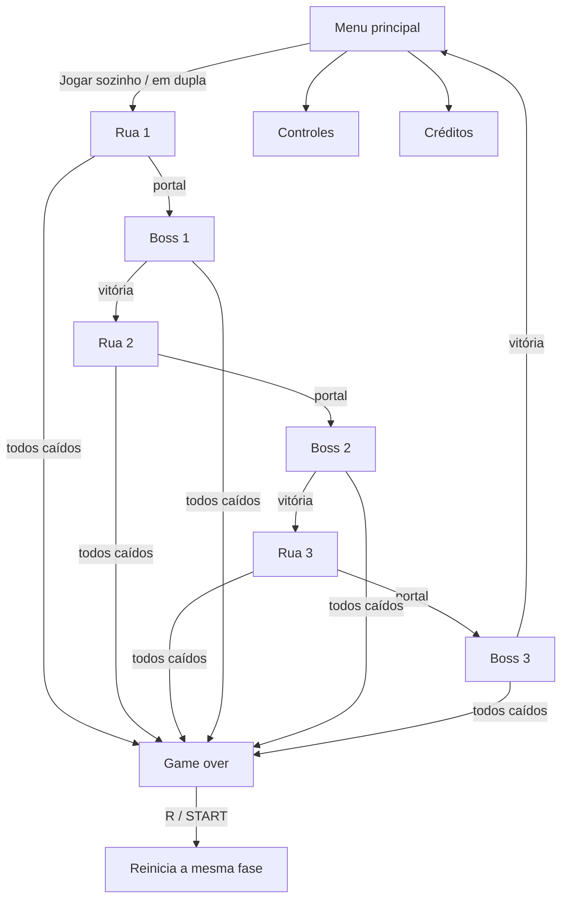
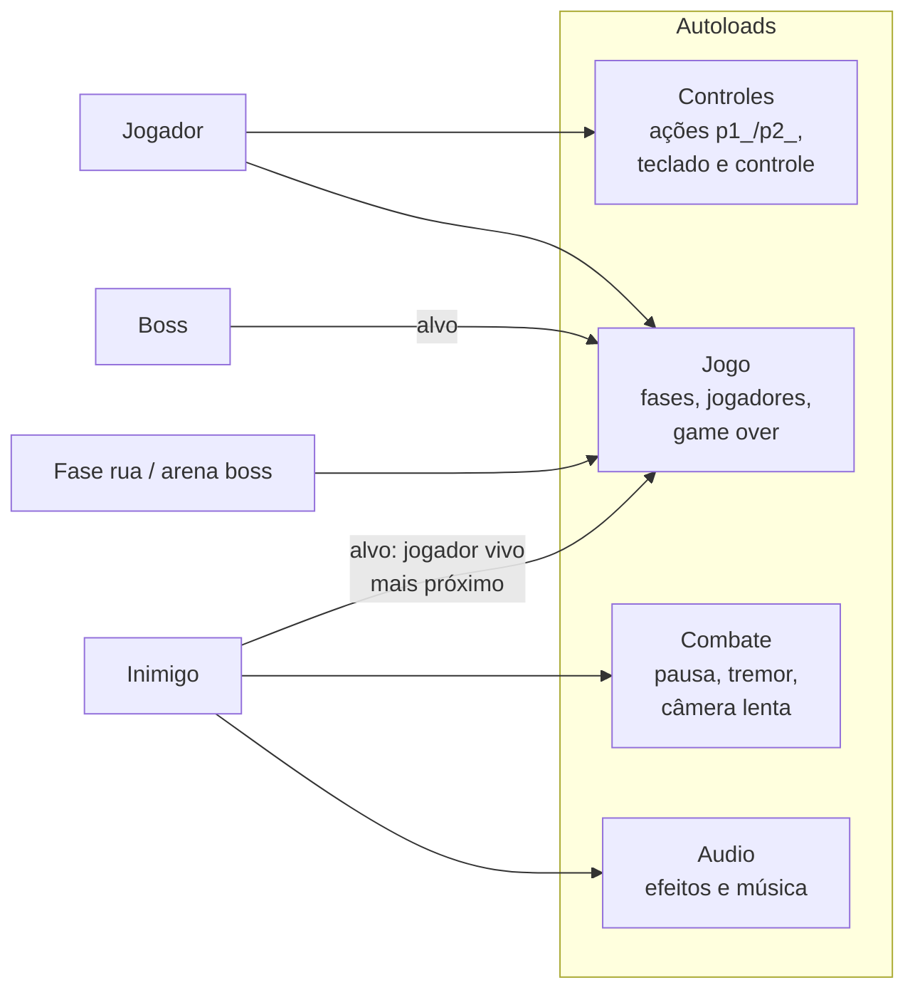
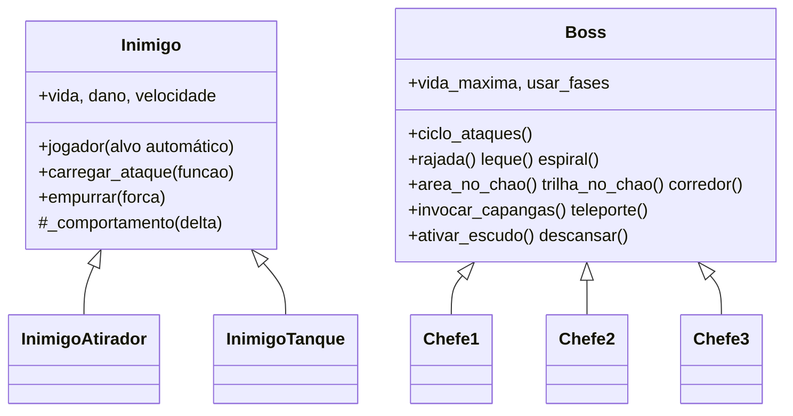

# MetalWorld: The Last Riff — Documentação técnica

> ExpoTech 2026.2 · UniFECAF · ADS 5º semestre (noite)
> Equipe: Lucas Gabriel Vieira do Nascimento (líder), Arthur Lima Pereira, Leonardo Malafaia Kalil Honeim



## Sumário

1. [Visão geral](#1-visão-geral)
2. [Problema e proposta](#2-problema-e-proposta)
3. [Público-alvo](#3-público-alvo)
4. [Requisitos](#4-requisitos)
5. [Funcionalidades](#5-funcionalidades)
6. [Mecânicas em detalhe](#6-mecânicas-em-detalhe)
7. [Fluxo de telas e fases](#7-fluxo-de-telas-e-fases)
8. [Arquitetura](#8-arquitetura)
9. [Controles](#9-controles)
10. [Qualidade e testes](#10-qualidade-e-testes)
11. [Processo de desenvolvimento](#11-processo-de-desenvolvimento)
12. [Identidade visual](#12-identidade-visual)
13. [Como executar](#13-como-executar)
14. [Créditos e licenças](#14-créditos-e-licenças)
15. [Próximos passos](#15-próximos-passos)

---

## 1. Visão geral

**MetalWorld: The Last Riff** é um jogo 2D de pancadaria lateral (*beat 'em up*) em pixel art, com **co-op local para 2 jogadores** e um diferencial: os chefes **só são derrotados no ritmo**, num minigame de guitarra chamado **Riff**.

A história acompanha **Dylan Walker**, um jovem que nasceu surdo e descobre a paixão pela música quando recebe um aparelho auditivo e ouve heavy metal pela primeira vez. Nas ruas, ele abre caminho no soco; diante de cada chefe, saca a guitarra e luta com música.

| | |
|---|---|
| Gênero | Beat 'em up + ritmo |
| Jogadores | 1 ou 2 (co-op local, mesma tela) |
| Plataforma | PC (Windows/Linux) |
| Motor | Godot 4.7 (GDScript), renderizador de compatibilidade |
| Estrutura | Rua 1 → Boss 1 → Rua 2 → Boss 2 → Rua 3 → Boss 3 |



## 2. Problema e proposta

**Problema.** Jogos de pancadaria costumam ser repetitivos no fim de fase: o chefe é só "mais um inimigo com mais vida". E jogos de ritmo raramente são jogados em dupla, no sofá, com outra pessoa.

**Proposta.** Unir os dois:
- **Nas ruas**, combate corpo a corpo justo e legível: inimigos avisam antes de bater, há profundidade (dá para passar na frente/atrás) e cooperação (levantar o parceiro caído).
- **No chefe**, a música é a arma. O chefe só perde vida pelo **Riff**: notas descem em pistas e os jogadores acertam no tempo. Em dupla, as notas vêm em **revezamento** (blocos de 4 notas, cada jogador na sua cor), e a dupla divide **uma vida só** contra o chefe (cabo de força).
- **Tema de inclusão.** O protagonista é surdo, e a música aparece também de forma **visual**: notas coloridas, aviso "RIFF!" e feedback na tela, para jogar sem depender só do som.

## 3. Público-alvo

- Jogadores casuais que gostam de jogar **em dupla no mesmo computador**.
- Fãs de beat 'em ups clássicos e de jogos de ritmo.
- Faixa etária: 12+ (violência cartunesca, sem sangue).

## 4. Requisitos

### 4.1 Funcionais

| ID | Requisito | Situação |
|---|---|---|
| RF01 | Menu principal com jogar sozinho, jogar em dupla, controles e créditos | ✅ Implementado |
| RF02 | Jogar com 1 ou 2 jogadores; o 2º pode entrar no meio da fase (START) | ✅ Implementado |
| RF03 | Teclado para o P1 e controle para o P2 (com teclado reserva para testes) | ✅ Implementado |
| RF04 | Combate corpo a corpo: socos alternados (jab e direto), esquiva (dodge) com stamina | ✅ Implementado |
| RF05 | Inimigos com ataque telegrafado (piscam antes de bater), alvo no jogador mais próximo e IA de grupo (2 atacam por vez, os outros cercam) | ✅ Implementado |
| RF06 | Fases de rua em arenas e ondas, com portal para o chefe | ✅ Implementado |
| RF07 | Objetos quebráveis (barris e caixotes) que soltam comida que cura | ✅ Implementado |
| RF08 | Jogador caído pode ser levantado pelo parceiro; game over só com os dois caídos | ✅ Implementado |
| RF09 | Chefe que só toma dano pelo minigame de ritmo (Riff) | ✅ Implementado |
| RF10 | Riff em revezamento entre os dois jogadores, com notas por cor | ✅ Implementado |
| RF11 | Chefe com fases, escudo de runas, capangas, teleporte e nota maldita | ✅ Implementado (Boss 1) |
| RF12 | Vida compartilhada da dupla contra o chefe (cabo de força) | ✅ Implementado |
| RF13 | Sequência de 6 fases, voltando ao menu ao fim | ✅ Implementado |
| RF14 | Ruas 2 e 3 e Bosses 2 e 3 com conteúdo próprio | 🛠 Em desenvolvimento (modelos jogáveis prontos) |

### 4.2 Não funcionais

| ID | Requisito |
|---|---|
| RNF01 | Rodar em PCs modestos: renderizador de compatibilidade (OpenGL), resolução base 1152×648 |
| RNF02 | Pixel art nítida: filtro *nearest*, sem borrão ao ampliar |
| RNF03 | Jogável com teclado e controle; menus navegáveis pelos dois |
| RNF04 | Testes automatizados sem janela (*headless*) cobrindo fases, co-op, combate e menu |
| RNF05 | Código e textos em português; organização de pastas por funcionalidade (padrão do Godot) |
| RNF06 | Visual configurado nas cenas (Inspector), para o editor mostrar o mesmo que o jogo |
| RNF07 | Uso apenas de assets com licença compatível, todos listados em `CREDITS.md` |

## 5. Funcionalidades

### Ruas (beat 'em up)



- **Socos alternados** (J / X): jab (1 de dano) e direto (2, empurra). O jogador para para bater; apertar durante o golpe guarda o próximo.
- **Dodge** (K / A) com stamina: atravessa inimigos e tiros.
- **Inimigos**: normal, rápido, atirador (tiro na faixa) e tanque (granada que estoura em 8 balas). Todos **carregam o golpe** piscando branco: dá para sair da faixa, desviar ou socar para cancelar. **IA de grupo** (estilo Castle Crashers): cada jogador tem 2 vagas de ataque, uma de cada lado; quem pega a vaga bate 2 vezes, recua e dá a vez, e os outros cercam o jogador pelos dois lados, à distância.
- **Profundidade**: colisão só nos pés; personagens passam na frente/atrás uns dos outros e dos objetos.
- **Impacto**: pausa curta e tremor de tela nos acertos; câmera lenta no último inimigo da rua.
- **Barris e caixotes** quebram na porrada e soltam maçã ou carne.

### Chefes (Riff)



- **Riff** (Espaço / LB): notas descem em 4 pistas (← ↑ ↓ →) a 150 BPM, no tempo da música. PERFECT e GOOD ferem o chefe.
- **Revezamento**: em dupla, blocos de 4 notas alternam P1 (rosa) e P2 (azul); só o dono acerta a própria nota.
- **Descanso**: o chefe se ajoelha e mostra "RIFF!": a hora segura de tocar.
- **Fases do chefe** (66% e 33% da vida): ataques novos, ritmo mais rápido, nota maldita e escudo.
- **Escudo de runas**: o Riff não fere até a dupla quebrar as runas no soco.
- **Cabo de força**: uma barra só, dupla × chefe. Dano em qualquer jogador cura o chefe; dano no chefe cura a dupla.



### Co-op

- P2 entra a qualquer momento; Dylan do P2 tem outra cor e anel azul.
- Quem cai fica no chão; o parceiro segura **E / B** perto para levantar (com metade da vida).
- Inimigos e chefe miram sempre um jogador **vivo**.

## 6. Mecânicas em detalhe

### Estados do jogador



### Ciclo do combate contra o chefe



### Dano e equilíbrio (valores principais)

| Item | Valor |
|---|---|
| Vida do jogador | 5 (cabo de força no chefe: dupla com 5 de 10) |
| Jab / direto | 1 / 2 de dano |
| Carga do ataque inimigo | 0,45 s (tanque 0,6 s) |
| Atacantes por jogador | 2 (um de cada lado), 2 golpes cada antes de dar a vez |
| Riff | 150 BPM; com fases, 6 PERFECT ≈ 1 fase do chefe |
| Velocidade de andar | ~2 corpos por segundo (proporcional ao tamanho) |

## 7. Fluxo de telas e fases



Cada **rua** tem arenas (uma tela cada) com ondas de inimigos; a câmera só avança quando a arena é limpa. Na última arena abre o **portal** para o chefe.

## 8. Arquitetura

### 8.1 Organização de pastas

Organizada **por funcionalidade** (recomendação do guia oficial do Godot): cena, script e sprites de cada coisa ficam juntos.

| Pasta | Conteúdo |
|---|---|
| `sistemas/` | Autoloads (serviços globais): `Jogo`, `Controles`, `Audio`, `Combate` |
| `personagens/dylan/` | Jogador (cena, script, marcadores, shader do P2, sprites) |
| `inimigos/` | `base/` (modelo `Inimigo`), `rapido/`, `atirador/`, `tanque/` |
| `bosses/base/` | Classe `Boss` (caixa de ferramentas de ataques), arena, runa, projéteis |
| `riff/` | HUD do Riff e notas |
| `objetos/` | Barril, caixote, comida, portal |
| `ui/` | Menu principal, HUD, cabo de força |
| `fases/` | `comum/` (script das ruas, ondas), `rua_1..3/`, `boss_1..3/` |
| `assets/` | Áudio, fundos, efeitos e projéteis compartilhados |
| `tests/` | Testes automatizados |

### 8.2 Serviços globais (autoloads)



- **Jogo**: sequência das 6 fases, entrada do P2, lista de jogadores vivos, consulta do jogador mais próximo, game over.
- **Controles**: cria ações por jogador (`p1_atacar`, `p2_atacar`…) e distribui os controles conectados.
- **Audio** e **Combate**: sons/música e sensação de impacto, usados por qualquer cena.

### 8.3 Modelos de extensão (como a equipe cria conteúdo)



- **Inimigo novo**: cena herdada de `inimigos/base/inimigo.tscn`. Se só bate de perto, não precisa de script (já vem com a IA de grupo); com comportamento diferente, um script `extends Inimigo` que só escreve `_comportamento()`.
- **Chefe novo**: script `extends Boss` que só escreve `ciclo_ataques()` combinando os ataques prontos.
- **Rua nova**: ondas montadas no editor com nós `PontoSpawn`; sem script novo.

### 8.4 Decisões técnicas

| Decisão | Motivo |
|---|---|
| Origem dos personagens nos pés e colisão só no chão | Profundidade de beat 'em up e ordem de desenho correta (y-sort) |
| Tiros acertam uma *Hurtbox* na altura do peito | Só acerta quem está na mesma faixa da rua |
| Visual gravado nas cenas, não em código | Editor mostra o mesmo que o jogo; equipe ajusta sem programar |
| Ações de controle por jogador geradas em código | Mesmo jogo serve 1 ou 2 jogadores, com ou sem controle |
| Áudio mudo em modo sem janela | Testes automatizados rodam sem placa de som |

## 9. Controles

| Ação | P1 (teclado) | P2 (controle) |
|---|---|---|
| Mover | WASD | Analógico / direcional |
| Socar | J | X |
| Dodge | K | A / RB |
| Interagir / levantar parceiro | E | B |
| Abrir/fechar Riff | Espaço | LB |
| Notas do Riff (← ↑ ↓ →) | Setas | X / Y / A / B ou direcional |
| Entrar na partida / reiniciar | Enter / R | START |

## 10. Qualidade e testes

Testes automatizados rodam o jogo **sem janela** e simulam os botões dos dois jogadores:

```bash
tests/rodar_testes.sh
```

| Teste | O que verifica |
|---|---|
| `teste_fases.gd` | Joga as 6 fases em sequência com 2 jogadores até voltar ao menu |
| `teste_coop.gd` | Entrada do P2, mira dos inimigos, levantar parceiro, game over, Riff em revezamento, reiniciar no meio do chefe |
| `teste_combate.gd` | Socos (alcance, faixa, empurrão), carga dos inimigos, atirador, profundidade, guitarra no Riff, tamanhos |
| `teste_novidades.gd` | Impacto, caixote e comida, ataques do chefe, escudo, fases, nota maldita, cabo de força |
| `teste_ia.gd` | IA de grupo: no máximo 2 atacando, revezamento, rodear à distância, não empilhar, vagas por jogador no co-op |
| `teste_menu.gd` | Navegação do menu, janelas de controles/créditos, iniciar sozinho/em dupla |

O script falha se **qualquer** teste falhar ou se aparecer erro de script durante a execução. Além disso, cada mudança visual é conferida por captura de tela.

## 11. Processo de desenvolvimento

- **Divisão**: Lucas (base do jogo, sprites no PixelLab, integração e revisão), Leonardo (Ruas 2 e 3), Arthur (Bosses 2 e 3).
- **Trello**: Ideias → Backlog aprovado → To do → Doing → Testando → Done. Cada cartão em Testando tem checklist de teste manual.
- **GitHub**: um branch por tarefa e Pull Requests pequenos a cada 2–3 dias, revisados antes de entrar na `main` (guia em [`GUIA_GIT.md`](GUIA_GIT.md); modelo de PR em `.github/pull_request_template.md`).
- **Regras do projeto** para a equipe e para assistentes de código: [`AGENTS.md`](../AGENTS.md).
- **Decisões em grupo**: votação das funcionalidades no WhatsApp (o que entrou e o que ficou de fora está registrado no Trello).

## 12. Identidade visual


- **Conceito**: palco de show de heavy metal: aço rebitado, letreiro com lâmpadas e neon rosa.
- **Logo**: placa "METAL WORLD" em letras góticas rosa (`docs/identidade/logo_metalworld.png`, também usada no menu).
- **Pixel art** em todo o jogo, ampliada sem filtro.

| Cor | Uso |
|---|---|
| `#FF4DB8` rosa | Marca, P1, títulos, notas do P1 |
| `#59E6FF` azul-ciano | P2, notas do P2 |
| `#E71982` rosa-choque | Botão aceso, destaques |
| `#493050` roxo-placa | Botões e molduras |
| `#292636` aço escuro | Placa do título |
| `#FFD94D` amarelo | Avisos e dicas |

## 13. Como executar

1. Instale o **Godot 4.7** (versão padrão, sem .NET).
2. Abra o arquivo `project.godot` e aperte **F5**.
3. Para jogar em dupla, conecte um controle (o P2 usa o controle; sem controle, o P2 tem teclado reserva: setas, Ctrl e Shift direitos).

## 14. Créditos e licenças

Todos os assets de terceiros, autores e licenças estão em [`CREDITS.md`](../CREDITS.md). Os sprites do Dylan e a interface foram gerados pela equipe no PixelLab; as músicas são CC0 e os efeitos sonoros foram criados no Bfxr.

## 15. Próximos passos

- Conteúdo próprio das Ruas 2 e 3 (inimigos novos) e dos Bosses 2 e 3 (padrões de ataque).
- Sprites próprios para inimigos e chefes (PixelLab).
- HUD, game over e vitória no mesmo estilo do menu.
- Ideias em avaliação: Riff com guitarra e bateria ao mesmo tempo; golpes especiais por sequência de setas.
